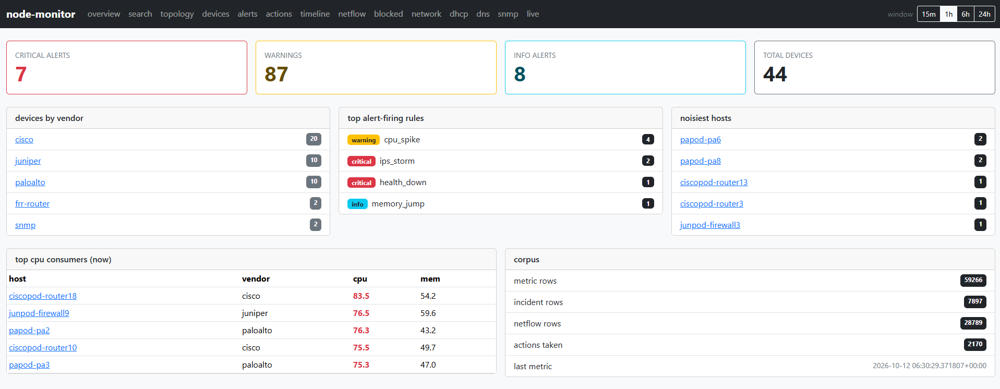
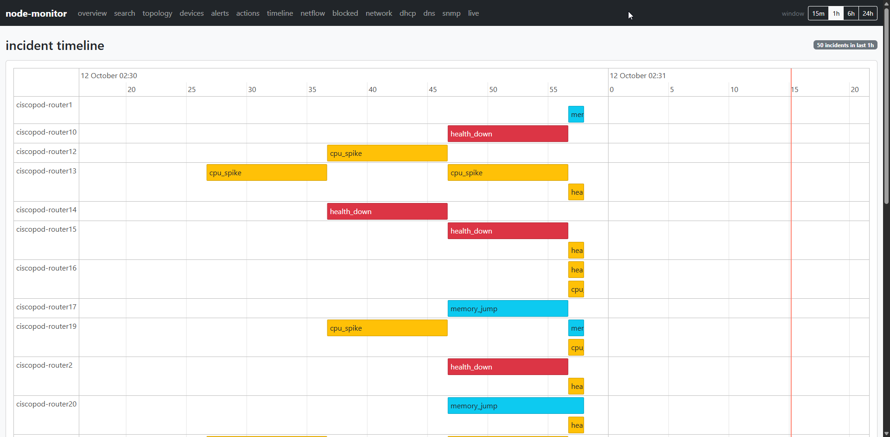
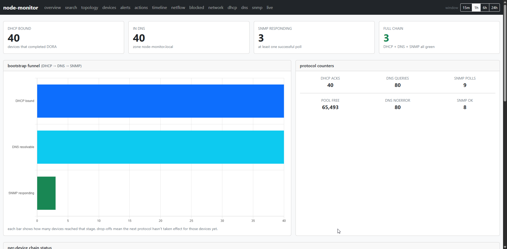

# node-monitor

A network monitoring system with automated incident response, inspired by Splunk. It collects metrics and traffic data from network devices in real time, detects anomalies, fires alerts, and runs automated remediation actions — all surfaced through a live web dashboard.







## What it does

- Ingests metrics (CPU, memory, health) from simulated Cisco, Juniper, and Palo Alto devices
- Receives NetFlow v5 traffic records and runs ACL evaluation on every flow
- Runs a built-in DHCP server, DNS server, and SNMP poller
- Fires alerts on rules like `cpu_spike`, `health_down`, `memory_jump`, and `ips_storm`
- Executes automated runbook actions when rules trip and logs every action taken
- Tracks the full device bootstrap chain: DHCP → DNS → SNMP
- Persists everything to PostgreSQL and serves a Flask dashboard with 15m / 1h / 6h / 24h time windows

## Dashboard

The dashboard has pages for:

| Page | What it shows |
|---|---|
| Overview | Alert counts, top CPU devices, noisiest hosts, top firing rules, corpus stats |
| Devices | Latest metric snapshot per device with health status |
| Alerts | Active and recently resolved incidents |
| Timeline | Gantt-style incident timeline per host, color-coded by severity |
| Netflow | Top talkers, top ports, protocol breakdown |
| Blocked | ACL deny breakdown — explicit vs implicit, by rule and src/dst pair |
| Network | DHCP→DNS→SNMP bootstrap funnel with per-device chain status |
| DHCP | Pool utilization, DORA activity over time, current lease table |
| DNS | Zone entries, query rcode breakdown |
| SNMP | Per-agent poll results, trap log |
| Search | Splunk-style search across metrics, incidents, flows, and actions |
| Live | Real-time metric stream |

## Tech Stack

| Layer | Technology |
|---|---|
| Collector | C++23 (gcc-14) |
| Dashboard | Python 3.12, Flask, Gunicorn |
| Device simulators | Python 3.12 |
| Database | PostgreSQL 16 |
| C++ ↔ Postgres | libpqxx 7 |
| Python ↔ Postgres | psycopg3 |
| BGP routing (observed) | FRR (Free Range Routing) — eBGP peering between two real daemons |
| Protocols implemented | DHCP, DNS, NetFlow v5, SNMP v2c (polling + traps) |
| Containerisation | Docker, Docker Compose |
| Cloud deployment | Kubernetes (AWS EKS), eksctl, kubectl |
| Build system | CMake 3.20+ |
| Tests | GoogleTest (121 tests) |

## Running locally

Build the images:

```bash
docker build -t node-monitor-collector:latest -f cc/Dockerfile cc/
docker build -t node-monitor-simulator:latest -f python/Dockerfile python/
docker build -t node-monitor-dashboard:latest -f dashboard/Dockerfile dashboard/
```

Start the stack:

```bash
docker compose up -d
```

| Service | URL |
|---|---|
| Dashboard | http://localhost:5000 |
| Collector API | http://localhost:8000 |

Tear down (wipes data):

```bash
docker compose down -v
```
